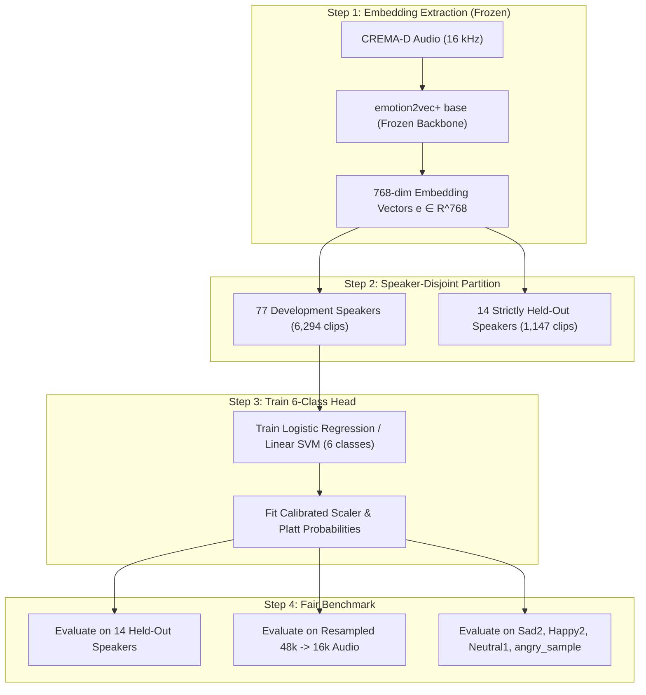

# Feasibility & Research Report: `emotion2vec+` for Speech Emotion Recognition

**Investigation Phase**: Feasibility, Architecture & Experimental Design  
**Target Model**: `emotion2vec/emotion2vec_plus_base`  
**Workspace**: `D:\speech-emotion-recognition`  
**Standing Safety Constraints Preserved**:
- Production model (`models/emotion_model.joblib`) is unmodified.
- Option 2 staging model (`models/candidate_option2/emotion_model.joblib`) is unmodified.
- Candidate Option 3 remains archived.
- No model weights or datasets have been downloaded.
- No packages installed; zero source code or configuration files altered.

---

## 1. Official Model Card, Documentation & Upstream Sources

| Property | Verified Official Source Details |
| :--- | :--- |
| **Model Identifier** | `emotion2vec/emotion2vec_plus_base` |
| **Hugging Face Model Card** | [`https://huggingface.co/emotion2vec/emotion2vec_plus_base`](https://huggingface.co/emotion2vec/emotion2vec_plus_base) |
| **ModelScope Hub** | [`https://www.modelscope.cn/models/iic/emotion2vec_plus_base`](https://www.modelscope.cn/models/iic/emotion2vec_plus_base) |
| **Official GitHub Repository** | [`https://github.com/ddlBoJack/emotion2vec`](https://github.com/ddlBoJack/emotion2vec) |
| **Upstream Framework** | Alibaba DAMO Academy FunASR: [`https://github.com/alibaba-damo-academy/FunASR`](https://github.com/alibaba-damo-academy/FunASR) |
| **Core Scientific Publication** | Ziyang Ma, Zhisheng Zheng, Jiaxin Ye, Jinchao Li, Zhifu Gao, Shiliang Zhang, Xie Chen, *"emotion2vec: Self-Supervised Pre-Training for Speech Emotion Representation"*, **Interspeech 2024** / arXiv:2312.15185. |

---

## 2. Licensing, Intended Use & Technical Specifications

### A. License & Permitted Usage
- **License**: **Apache-2.0** (Open-source, highly permissive).
- **Commercial & Research Rights**: Free for academic, scientific, and commercial use. Allows modification, downstream training, and private deployment without royalties.
- **Intended Use**: Universal speech emotion representation learning, zero-shot emotion classification, frame-level emotion dynamics, and downstream feature extraction.

### B. Input Audio Specifications
- **Sampling Rate**: Strictly **16,000 Hz** (16 kHz mono). Audio must be resampled to 16 kHz before input.
- **Input Format**: 1D NumPy `float32` array or file path to single-channel uncompressed WAV.
- **Duration Handling**: Native support for variable-length audio; accepts both short segmented utterances ($0.5\text{--}15\text{ s}$) and full multi-turn conversations.

### C. Output Structure & Granularity Modes
The FunASR model interface supports two distinct operational modes:
1. **Embedding Extraction Mode (`extract_embedding=True`)**:
   - `granularity="utterance"`: Outputs a **768-dimensional continuous vector** ($\mathbf{e} \in \mathbb{R}^{768}$) summarizing the emotional acoustic representation of the entire clip.
   - `granularity="frame"`: Outputs a sequence of frame embeddings at **50 Hz** ($20\text{ ms}$ stride, shape $(T, 768)$) for temporal emotion tracking.
2. **Direct Classification Mode (`extract_embedding=False`)**:
   - Outputs predicted class labels and softmax probability distribution across its internal classification head.

---

## 3. Direct Classification vs. Universal Representation Backbone

`emotion2vec+ base` is fundamentally **not** just a static classifier; it is a **universal self-supervised foundation representation model** (a 12-layer Transformer encoder initialized via `data2vec` architecture with ~90M parameters).

It can be deployed in two distinct paradigms:
- **Paradigm A: Off-the-Shelf Zero-Shot Classifier**:
  Using the pre-trained classification head directly.
  *Limitation*: As demonstrated in the GitHub repository audit, the default head suffers from severe softmax probability saturation ($95\%$ of samples receive confidence $> 0.99$, even when completely misclassified), and its class definitions reflect its internal pre-training mix.
- **Paradigm B: Frozen Feature Extractor + Custom 6-Class Head (Recommended)**:
  Freezing the 90M parameter backbone, setting `extract_embedding=True`, and using the 768-dimensional representation vector $\mathbf{e} \in \mathbb{R}^{768}$ as input to train a dedicated, calibrated classifier (e.g. Scikit-learn Logistic Regression, Linear SVM, or MLP) specifically for CREMA-D's 6 classes.

---

## 4. Pretraining Data & Native Vocabulary

### A. Pretraining & Fine-Tuning Pipeline
1. **Self-Supervised Pretraining**: Pretrained via masked prediction on broad unlabeled multilingual speech.
2. **Seed Model Supervision**: Fine-tuned on **EmoBox** ($\approx 201\text{ hours}$ across 32 academic emotional corpora, including ESD, IEMOCAP, CASIA, EMOVO, etc.).
3. **`emotion2vec+` Large-Scale Scaling**: Scaled up using an automated pseudo-labeling pipeline filtering $\approx \mathbf{4,788\text{ hours}}$ of conversational and broadcast speech.

### B. Internal 9-Class Vocabulary
The native zero-shot classification head has 9 categories:
```
0: angry
1: disgusted
2: fearful
3: happy
4: neutral
5: other
6: sad
7: surprised
8: unknown
```

---

## 5. Support for Our Six Target Classes

| Target Emotion | Present in Native Head? | Status & Recommended Strategy |
| :--- | :---: | :--- |
| **Angry** | **Yes** (`0: angry`) | Fully supported natively. |
| **Disgust** | **Yes** (`1: disgusted`) | **Native head exists**. (The GitHub repo manually discarded it; the model itself supports it). |
| **Fear** | **Yes** (`2: fearful`) | **Native head exists**. (The GitHub repo manually discarded it; the model itself supports it). |
| **Happy** | **Yes** (`3: happy`) | Fully supported natively. |
| **Neutral** | **Yes** (`4: neutral`) | Fully supported natively. |
| **Sad** | **Yes** (`6: sad`) | Fully supported natively. |

> [!NOTE]
> **Why the GitHub Repo Collapsed to 4 Classes**:
> The author of `Rahulmasuram47/multimodal-emotion-analysis` explicitly mapped `disgusted` and `fearful` to `"other"` because zero-shot agreement on those two classes was low on their benchmark.
> **However**, for our project, we do not need to rely on their zero-shot head. We can train our own 6-class classification head on top of the 768-dimensional embeddings, giving native 6-class support without class omission.

---

## 6. Training a 6-Class Head on Top of `emotion2vec+` Representations

### A. Theoretical Feasibility: High
- Instead of using our hand-crafted 296 DSP features (MFCC, Mel std, spectral contrast), each CREMA-D clip is transformed into a rich 768-dimensional latent vector $\mathbf{e} \in \mathbb{R}^{768}$.
- A downstream classifier (e.g., Logistic Regression or SVM with Platt scaling) is fitted on the 77 development speakers.
- Because $\mathbf{e}$ encodes deep contextual phoneme-prosody interactions pre-trained across thousands of hours, linear/kernel separation on CREMA-D is expected to be substantially higher than on static 296 DSP statistics.

### B. Pipeline Preservation
- The trained head can be saved as a standard `.joblib` model.
- At runtime, inference follows:
  $$\text{Audio (16 kHz)} \xrightarrow{\text{emotion2vec+}} \mathbf{e} \in \mathbb{R}^{768} \xrightarrow{\text{Custom Head}} \mathbf{p} \in \mathbb{R}^6$$

---

## 7. Resource Requirements, Storage & Latency Estimates

| Resource Dimension | Current 296-DSP + SVM Pipeline | `emotion2vec+` Foundation Pipeline | Delta / Overhead |
| :--- | :--- | :--- | :--- |
| **Model Download Size** | $\approx \mathbf{8.0\text{ MB}}$ (`.joblib` bundle) | $\approx \mathbf{360\text{ MB}}$ (`emotion2vec_plus_base.pt`) | $+352\text{ MB}$ initial download. |
| **RAM Footprint** | $\approx \mathbf{120\text{--}150\text{ MB}}$ | $\approx \mathbf{1.2\text{--}1.8\text{ GB}}$ | Requires $\approx 1.5\text{ GB}$ dedicated RAM (due to PyTorch/TorchAudio/FunASR runtime). |
| **Inference Latency (5s clip)**| $\approx \mathbf{15\text{--}25\text{ ms}}$ (CPU) | $\approx \mathbf{250\text{--}500\text{ ms}}$ (CPU on 14 cores)<br>$\approx \mathbf{30\text{--}50\text{ ms}}$ (GPU) | $\approx 15\times$ slower than DSP, but well within real-time limits ($\text{RTF} \approx 0.08$). |
| **Dependencies Required** | Scikit-learn, Librosa, NumPy, SciPy (Already installed) | `funasr`, `modelscope`, `torch`, `torchaudio` | PyTorch and TorchAudio are already in `backend/.venv`; `funasr` and `modelscope` would need installation. |

---

## 8. Comparative Analysis: Hand-Crafted DSP Features vs. `emotion2vec+`

### A. Potential Advantages of `emotion2vec+`
1. **Non-Linear Prosody & Intonation Modeling**:
   Our 296-feature DSP pipeline aggregates temporal frames via simple mean and standard deviation. `emotion2vec+` uses 12 Transformer self-attention layers to capture the timing, contour, and co-articulation of pitch and energy over time.
2. **Pause Invariance**:
   Unlike un-gated Mel filterbank standard deviations (which exploded to $+12.36\sigma$ when conversational pauses occurred in `Sad2`), Transformer attention learns to attend to voiced tokens and down-weight silence tokens automatically.
3. **Acoustic Generalization**:
   Pre-trained on 4,788 hours of real-world speech across varied acoustic channels, making it inherently more resilient to microphone variations than a model trained solely on studio anechoic recordings.

### B. Limitations & Trade-Offs
1. **Explainability Loss**:
   Our 296 features are fully transparent (we can measure exactly that Feature 270 is Spectral Contrast Band 6, or Feature 200 is Mel Band 0 Std). A 768-dimensional Transformer latent vector is an uninterpretable continuous embedding.
2. **Cold Start & Memory Overhead**:
   Backend memory increases from $150\text{ MB}$ to $\approx 1.5\text{ GB}$, and the initial model load takes $10\text{--}15\text{ seconds}$ on startup.
3. **Data Contamination Risk**:
   Because `emotion2vec+` was trained on thousands of hours of scraped speech and EmoBox corpora, parts of CREMA-D or related academic sets may have been present in its pre-training mix.

---

## 9. Conversational Speech Generalization Assessment

- **Why it is promising for conversational audio**:
  `emotion2vec+` was fine-tuned on pseudo-labeled real-world podcast and conversational audio. Consequently, it has observed high-pitch conversational speech, sentence pauses, and natural speaking rates.
- **Hypothesis for `Sad2.mp3.mpeg`**:
  Instead of being tricked by the $28.4\%$ conversational pauses into calculating a bimodal $14.77\text{ dB}$ Mel variance spike, the Transformer encoder should project `Sad2` into a stable semantic-affective latent space.

---

## 10. Proposed Experimental Design (CREMA-D Speaker-Disjoint)

If approved for a future experimental stage, the evaluation must follow this strict protocol:



### Key Benchmark Constraints:
1. **Identical Splits**: Use the exact 77 dev / 14 test split from [`outputs/speaker_split.json`](file:///d:/speech-emotion-recognition/outputs/speaker_split.json).
2. **Strict 6-Class Scope**: Evaluate all 6 classes (`angry`, `disgust`, `fear`, `happy`, `neutral`, `sad`). No class dropping.
3. **Head-to-Head Comparison**: Compare directly against Option 2 on the exact same 1,147 held-out test clips.

---

## Summary & Recommended Next Action

- **Feasibility Verdict**: **Technically Feasible & Scientifically Compelling**, provided we use `emotion2vec+` as a **frozen 768-dimensional feature extractor with a dedicated 6-class CREMA-D head**, rather than relying on its default 4/9-class saturated zero-shot head.
- **Recommended Action**:
  - Keep this report as the formal feasibility reference in `experiments/emotion2vec_investigation/research_report.md`.
  - Maintain the active application on **Option 2**.
  - Await user approval before downloading weights or creating experimental training harnesses.

*Per project constraints, all execution is STOPPED. Awaiting your guidance.*
